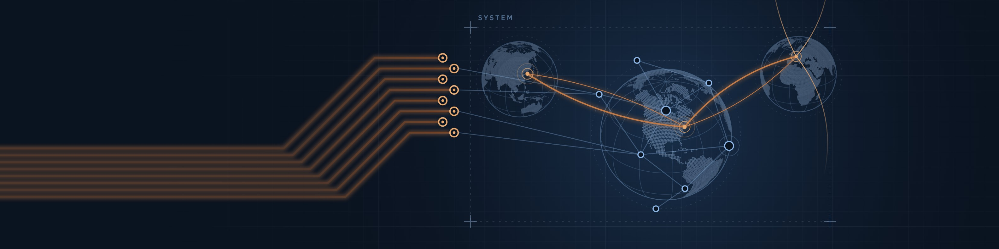
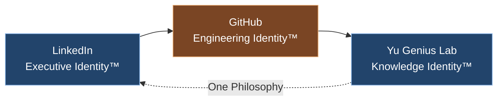

  

# Edison Yu

> **Technology has been the medium.**  
> **Integration has been the journey.**  
> **Human intention, trust, and connection remain the destination.**

Technology Executive · Engineering Leader · Systems Thinker  
Founder, Yu Genius Lab™ · Creator of GOE™ · Builder of GOE Global™

This is the **Engineering Repository™** of Edison Yu: how I design systems, document architecture, and turn ideas into platforms.

[LinkedIn](https://www.linkedin.com/in/ilsooedisonyu/) records the experience.  
[Yu Genius Lab](https://www.yugeniuslab.com/) publishes the knowledge.  
GitHub shows the engineering.

---

## Identity

- **Technology Executive** and former **Chief Technology Officer at Key Digital**
- **Founder, Yu Genius Lab™**, a personal research and publishing platform
- **Creator of GOE™**, a human-centered operating framework built around identity, trust, authorization, human intention, and execution boundaries
- **Builder of GOE Global™**, the expansion of trusted connection beyond GOE Lab
- **Author of Engineering Philosophy™**
- **Author of GOE Operating System™: The Eight-Level Engineering Evolution Framework**
- **Documentation-First Engineer**

One continuous engineering journey:

**Physical World → Embedded Systems → Software → Full-Stack Platforms → GOE → GOE Global**

---

## Current Focus

- Human-Centered Platform Architecture
- World Model Design
- AI-Assisted Engineering
- Documentation-First Development
- Identity and Trust Systems
- Trusted connection between people, AI, and physical systems
- Backend and Platform Engineering
- Systems Integration

---

## Featured Repositories

| Repository | The Question It Answers | What You Will Find |
|------------|------------------------|-------------------|
| [yu-genius-lab-backend](https://github.com/ilsooedisonyu/yu-genius-lab-backend) | How do I build? | Architecture records, platform boundaries, engineering decisions, and backend design principles |
| [goe-architecture](https://github.com/ilsooedisonyu/goe-architecture) | How does GOE operate? | GOE architecture, world models, trust systems, identity systems, and operating structures |
| [engineering-philosophy](https://github.com/ilsooedisonyu/engineering-philosophy) | What do I believe? | Engineering perspectives, principles, lessons learned, and systems thinking |
| [goe-operating-system](https://github.com/ilsooedisonyu/goe-operating-system) | What have I published? | The GOE Operating System™ white paper and supporting framework materials |
| [python-backend-philosophy](https://github.com/ilsooedisonyu/python-backend-philosophy) | How do I engineer software? | Documentation-first development, architecture-first thinking, and AI-assisted engineering |
| [open-knowledge](https://github.com/ilsooedisonyu/open-knowledge) | What defines everything? | Canonical definitions, vocabulary, frameworks, and ecosystem references |

---

## Current Research

Research happens in **GOE Lab™**, the experimentation and architecture workspace within the ecosystem.

- Multi-AI engineering collaboration guided by human intention
- Human-authorized execution
- Identity, trust, authorization, and relationship modeling
- World model design for people, AI, and physical systems
- Documentation-first development with AI as an engineering partner
- One source, every format: web, PDF, and AI-readable knowledge

---

## Engineering Philosophy

> **An idea counts only once it is implemented.**  
> **Most failures emerge at boundaries.**  
> **Connection without trust becomes risk.**

Architecture before implementation.  
Documentation before development.  
Systems before components.

*AI assists. Human intention remains the source.*

---

## Architecture Principles

1. **Architecture before implementation.** Systems must be understood before they are built.
2. **Documentation before development.** Documentation bridges ideas, architecture, implementation, and maintenance.
3. **Systems before components.** Products, software, organizations, operations, data, AI, and people are connected systems.
4. **Boundaries are designed, then enforced.** Dependencies should be intentional and verifiable.
5. **One source of truth.** Every format should originate from the same canonical source.
6. **Identity, trust, and authorization are platform primitives.** They are foundational, not optional.
7. **Humans authorize.** AI participates, advises, and assists; humans remain accountable.
8. **Maintainability over complexity.** Systems should evolve without accumulating unnecessary complexity.

---

## The Ecosystem

This ecosystem operates as one continuous system.

Edison Yu creates intention.  
Yu Genius Lab publishes knowledge.  
GOE provides the operating framework.  
GOE Lab enables trusted participation.  
GOE Global expands trusted connection.

---

## Contact

- **Website:** https://www.yugeniuslab.com
- **LinkedIn:** https://www.linkedin.com/in/ilsooedisonyu/
- **Email:** edison@ne World. One Connection. Infinite Possibilities. · Engineering Repository™ · Profile README Revision 2026.70

---